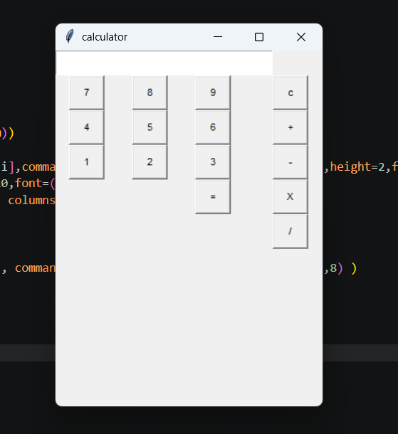
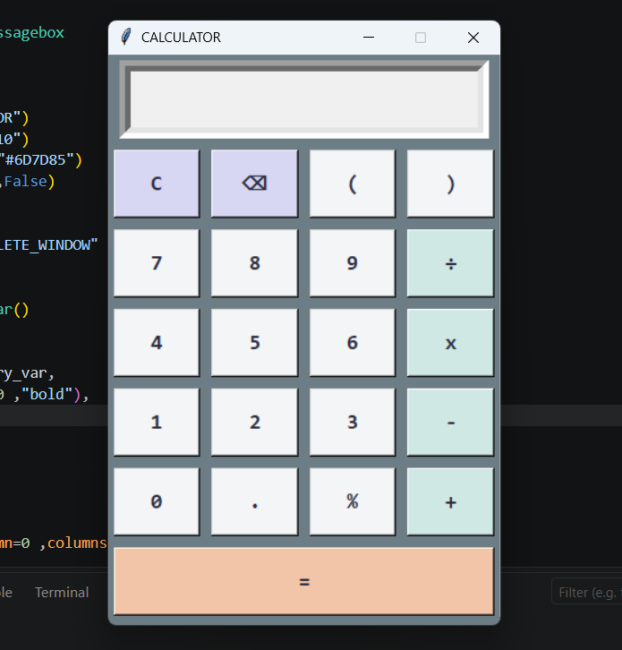

# Tkinter Desktop Calculator (v1.0 vs v2.0) 🚀
A Python GUI Calculator application built using Tkinter, showcasing my progress and learning journey in GUI development, layout management, and clean code principles.
## 📌 Project Overview
This repository demonstrates the evolution of my calculator app from a basic functional prototype to an improved, well-structured, and visually appealing desktop application.
---
## 🆚 Version Comparison
### 📍 Version 1.0 (Basic Prototype)
* Focus: Basic arithmetic logic and functional buttons.
* Layout: Initial attempt with Tkinter grid layout.
### 📍 Version 2.0 (Enhanced Design)
* Focus: Improved UI/UX, better layout alignment, expanded features, and structured styling.
* Key Additions:
  * Clean button grid alignment and responsive spacing.
  * Added features: Backspace (⌫), Parentheses (), and Percentage %.
  * Highlighted Action Button (Equal =).
---
## 📸 Screenshots

| Version 1.0 (Old) | Version 2.0 (New) |
| :--- | :--- |
|  |  |

---
## 🛠️ Built With
* Python 3.x
* Tkinter (GUI Library)